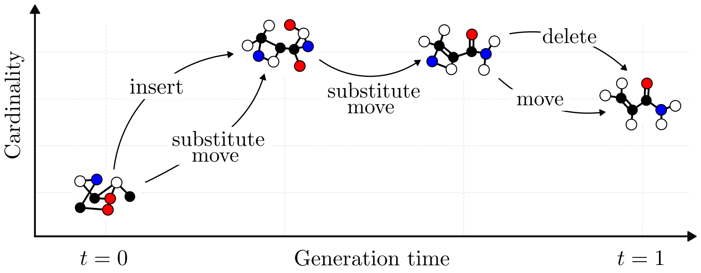

<h1 align="center">Morph</h1>

<p align="center">
  <strong>Generative Molecular Morphing for Flexible-Size Design<br>
  via Unbalanced Optimal Transport</strong>
</p>

<p align="center">
  Malte Franke · Stefan P. Schmid · Zarko Ivkovic · Kjell Jorner · Andreas Krause
</p>

<p align="center">
  <a href="https://arxiv.org/abs/2606.07239v1">Paper: arXiv v1 · June 2026</a> ·
  <a href="pyproject.toml">Code version: 0.1.0</a>
</p>

<p align="center">
  <a href="https://huggingface.co/maltefranke/morph">Models</a> ·
  <a href="https://huggingface.co/datasets/maltefranke/morph-data">Data</a> ·
  <a href="#further-documentation">Documentation</a> ·
  <a href="#citation">Citation</a>
</p>

Flow-matching molecular generation on QM9, GEOM-Drugs, and ChEMBL3D, including
scaffold-decoration fine-tuning. A molecular diffusion transformer (DiT)
predicts clean coordinates, atom and bond types, charges, and edit posteriors.
The sampler combines those predictions with time schedules to move, insert,
delete, and substitute atoms and bonds.

<p align="center">
  <a href="media/main_figure.pdf">
    
  </a>
</p>

## Installation

Python 3.13 is recommended; Python 3.11–3.13 is supported. The first PyPI
release is being prepared. Once it is available, install in a virtual environment:

```bash
python3.13 -m venv .venv
source .venv/bin/activate
python -m pip install morph-chem
```

To install the current source checkout before publication, use
`python -m pip install .` from the repository root in your environment.
The package provides the `morph` command and Python API. Training, preprocessing,
and the evaluation scripts use a source checkout; see [Training quick start](#training-quick-start).

## Pretrained models

[Checkpoints on Hugging Face](https://huggingface.co/maltefranke/morph)
include QM9 with explicit hydrogens (epochs 1,000 and 1,500), GEOM-Drugs with
explicit hydrogens (epochs 50 and 100), and ChEMBL3D with explicit hydrogens
(epochs 200, 300, 400) or implicit hydrogens (epochs 100, 200, 300).

After installation, discover models and generate molecules on a CUDA GPU without
preparing a dataset:

```bash
morph models list
morph models download chembl3d-implicit-h --epoch 300
# Run generation on a compute worker:
morph generate --model chembl3d-implicit-h --epoch 300 \
  --device cuda --batch 64 --batch-size 16 --output molecules.sdf
```

The published models are public and do not require a Hugging Face login.
Weights download on first use and are cached. For a small CPU run, use
`--device cpu --batch 1 --batch-size 1`; generation is slower on CPU.

Python loading is equally direct:

```python
from morph.inference import load_pretrained

model = load_pretrained("chembl3d-implicit-h", epoch=300, device="cuda")
```

The loader fetches the selected weights, config, vocabularies and distributions
and constructs only one network (EMA by default; `use_ema=False` selects current
weights). `morph models list` discovers shortcuts from the Hub's `catalog.json`;
`--offline` reads the cached catalog. Adding a release requires updating that
manifest, with each entry pointing to its model release. You can also pass any
Hugging Face `owner/repo` with `subfolder` and `revision`, or load a local bundle
with `load_pretrained(weights_dir="/path/to/bundle")`. See [inference](docs/inference.md) for sampling,
offline use, checkpoint selection and adding new model releases.

## Reproducibility

Each model has a **training bundle** with its original training configuration,
launch settings, frozen source, dependency versions and data references.
The bundles live alongside the corresponding model files on Hugging Face:

| Model | Configuration and source |
| --- | --- |
| QM9, explicit H | [Training bundle](https://huggingface.co/maltefranke/morph/resolve/main/qm9/explicit_h/training_bundle.tar.gz) |
| GEOM-Drugs, explicit H | [Training bundle](https://huggingface.co/maltefranke/morph/resolve/main/geom/explicit_h/training_bundle.tar.gz) |
| ChEMBL3D, explicit H | [Training bundle](https://huggingface.co/maltefranke/morph/resolve/main/chembl3d/explicit_h/training_bundle.tar.gz) |
| ChEMBL3D, implicit H | [Training bundle](https://huggingface.co/maltefranke/morph/resolve/main/chembl3d/implicit_h/training_bundle.tar.gz) |

For example, download and unpack the GEOM training bundle:

```bash
hf download maltefranke/morph geom/explicit_h/training_bundle.tar.gz --local-dir .
tar -xzf geom/explicit_h/training_bundle.tar.gz
```

Each bundle also includes a portable training recipe; its changes from the
original run are recorded alongside it. See the [training bundle guide](docs/reproducibility.md)
for setup, data requirements and resuming. Version identifiers and checksums
are recorded in the release metadata and bundle manifests.

## Training quick start

Preprocessed splits, vocabularies, statistics, and saved scaffold cuts are
available in the public
[Morph data repository](https://huggingface.co/datasets/maltefranke/morph-data).
Download a cache into this checkout and skip preprocessing:

```bash
hf download maltefranke/morph-data --type dataset --include 'qm9/**' --local-dir data
```

Replace `qm9/**` with `geom/**`, `chembl3d/**`, `chembl3d_max100/**`,
`chembl3d_max100_implicit_h/**`, or `crossdocked/**` as needed. The released
ChEMBL3D checkpoints use the two `max100` caches; the dataset card documents the
matching training bundles.

Install [uv](https://docs.astral.sh/uv/). The checkout defaults to Python 3.13 and the package allows Python 3.11–3.13. From the repository root:

```bash
bash setup_env.sh
source .venv/bin/activate
source .env

# Choose geom, qm9, or chembl3d; the workflow is the same for each.
dataset=geom
python scripts/preprocess.py "$dataset"
python run.py defaults="$dataset/$dataset"
```

Running `python run.py` without a dataset override selects GEOM-Drugs with
explicit hydrogens and the released GEOM model's parameters.

Setup installs the versions in `uv.lock` and creates `.env` only when it is
absent. Runs are written to `outputs/runs/` by default. To choose another artifact root,
set `MORPH_SCRATCH` before running setup. Training uses W&B by default; add
`logging.enabled=false` for a local run without W&B logging.

For CrossDocked, use `bash setup_env.sh --extra crossdocked`. This also installs
the optional docking tools on Linux x86_64; see the
[docking setup](docs/evaluation.md#crossdocked-docking-requirements-and-reproduction-limits).

`scripts/preprocess.py` downloads missing source files into `data/<dataset>/raw/`,
processes the train/validation/test splits, and computes vocabularies and training
statistics in `data/<dataset>/processed/`. Rerunning it reuses completed files.
No manual download or source directory is required. Run preprocessing once on a
CPU worker before starting distributed training; add `--workers 20` to choose
the number of preprocessing workers.

GEOM and ChEMBL3D support heavy-atom graphs with implicit hydrogens. Choose
`--hydrogen-mode implicit` when preprocessing, then select the matching recipe:

```bash
python scripts/preprocess.py "$dataset" --hydrogen-mode implicit
python run.py defaults="$dataset/implicit_h"
```

Set `dataset` to `geom` or `chembl3d` for this option. It uses a separate
`data/<dataset>_implicit_h/` cache with its own vocabularies and statistics.
See [training and data options](docs/training.md) for filters and optional local
source overrides.

GPU training compiles both current and EMA models by default. For short smoke
tests, use `MORPH_COMPILE=0`. The full training defaults require a GPU; a small
CPU run can be requested explicitly:

```bash
MORPH_COMPILE=0 python run.py logging.enabled=false \
  trainer.trainer.accelerator=cpu trainer.trainer.devices=1 \
  trainer.trainer.strategy=auto integrator.integrator.num_integration_steps=2 \
  trainer.trainer.precision=32-true +trainer.trainer.fast_dev_run=true \
  data.datamodule.num_workers.train=0 data.datamodule.batch_size.train=2 \
  data.datamodule.batch_size.val=2 data.datamodule.batch_size.test=2
```

## Scaffold decoration

The [data repository](https://huggingface.co/datasets/maltefranke/morph-data)
includes saved atom-index cuts for all three splits:

| Dataset | Published scaffold kinds |
| --- | --- |
| QM9 | `murcko`, `heavy` |
| GEOM-Drugs | `murcko`, `libinvent`, `linker` |
| CrossDocked (implicit H) | `libinvent`, with matching ligand/pocket LMDBs |

Download `qm9/**`, `geom/**`, or `crossdocked/**` to get both the source data and
its saved cuts. These are existing cut lists with portable source checksums;
moving the files does not regenerate scaffolds. Dataset loading constructs
examples from the saved atom selections. Evaluation panels are selected on first
use; QM9/GEOM panels are also cached. The dataset card records artifact provenance
and checksums.

Fine-tune a pretrained unconditional DiT while conditioning on retained atoms:

```bash
python run.py defaults=qm9/scaffold_decoration \
  model.module.pretrained_ckpt=/path/to/unconditional.ckpt \
  data.scaffold_kind=murcko
```

Supported retained structures are Murcko scaffolds, BRICS fragments (`rgroup`),
LibINVENT reaction cuts, heavy atoms, and fragments for linker generation.
Unpublished kinds such as `rgroup` are computed and cached on first use. To
compute new LibINVENT cuts, install `uv sync --extra scaffold`. The first use
downloads the original reaction and filter files from pinned upstream revisions,
checks their SHA-256 hashes, and caches them for offline reuse. Downloaded scaffold
caches can be read without fetching these rules. Resources and verified source
checksums live under `${XDG_CACHE_HOME:-~/.cache}/morph`; set `MORPH_CACHE_DIR` to
choose another location shared by training processes. CrossDocked
fine-tuning uses the pretrained model's ligand vocabulary and statistics;
the released caches match `chembl3d_max100_implicit_h/processed`. See
[training and fine-tuning](docs/training.md) for their semantics and LoRA options.

## LogP-conditioned generation

Absolute-logP-conditioned generation is available for QM9 and GEOM through
`defaults=qm9/logp` and `defaults=geom/logp`, with fully trainable pretrained
backbones. See [logP fine-tuning](docs/training.md#logp-conditioned-generation)
for property preparation, checkpoints, and validation metrics.

## Reading the implementation

The main data path is:

```text
Dataset → prior/target alignment → interpolation → collated training batch
        → DiT endpoint/edit predictions → per-graph losses → optimizer/EMA
```

Sampling repeatedly decodes predictions, applies task masks, integrates edits,
and recenters coordinates. Output coordinates are restored to Angstroms.

| Entry point | Purpose |
| --- | --- |
| [run.py](run.py) | Training, validation, and prediction orchestration |
| [scripts/preprocess.py](scripts/preprocess.py) | Automatic dataset download, processing and statistics |
| [model/build.py](src/morph/model/build.py) | Shared model and metric construction |
| [flow_matching/](src/morph/flow_matching/) | Assignment, interpolation, schedules, and integration |
| [dataset/core/](src/morph/dataset/core/) | Molecular batches and structured insertion targets |
| [model/lightning/](src/morph/model/lightning/) | Training lifecycle, losses, sampling, and EMA |
| [configs/](configs/) | Dataset and model recipes |
| [tests/model/](tests/model/) | Regression tests grouped by subject |

The [model contract](src/morph/model/README.md) documents tensor shapes,
coordinate conventions, conditioning ports, and the loss-to-head mapping.

## Further documentation

- [Training, configurations, and fine-tuning](docs/training.md)
- [Inference and model bundles](docs/inference.md)
- [Reproducing released models and training runs](docs/reproducibility.md)
- [Runtime, compilation, and performance](docs/performance.md)
- [Running on a Slurm cluster](docs/slurm.md)
- [Development and regression checks](docs/development.md)
- [Release metadata](docs/release.md)

## Citation

If you use Morph, please cite our [paper](https://arxiv.org/abs/2606.07239):

```bibtex
@misc{franke2026generativemolecularmorphingflexiblesize,
      title={Generative Molecular Morphing for Flexible-Size Design via Unbalanced Optimal Transport},
      author={Malte Franke and Stefan P. Schmid and Zarko Ivkovic and Kjell Jorner and Andreas Krause},
      year={2026},
      eprint={2606.07239},
      archivePrefix={arXiv},
      primaryClass={cs.LG},
      url={https://arxiv.org/abs/2606.07239},
}
```

Machine-readable citation metadata is available in [CITATION.cff](CITATION.cff).
Morph is distributed under the [MIT License](LICENSE). Upstream licenses and
source attribution for vendored code and adaptations are collected in the
[third-party inventory](src/morph/_vendor/README.md).
